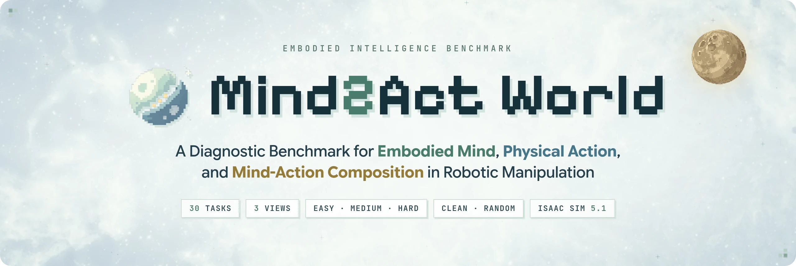
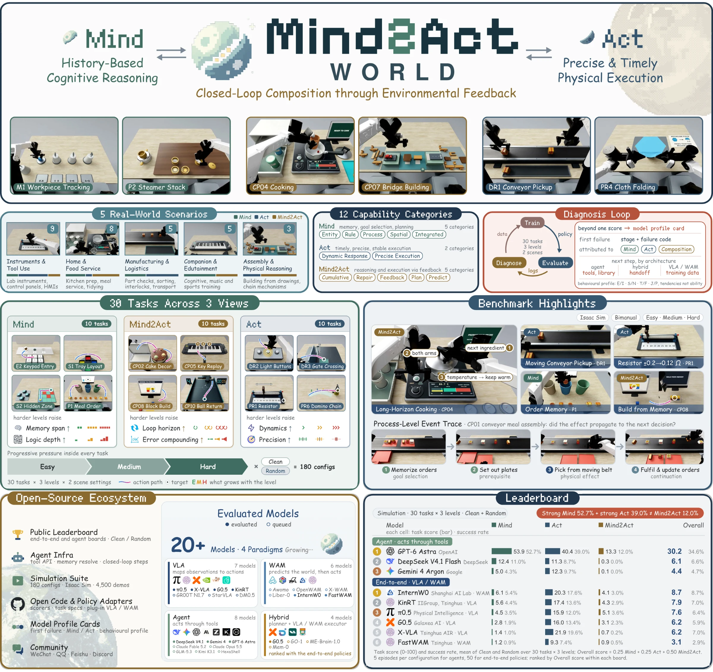
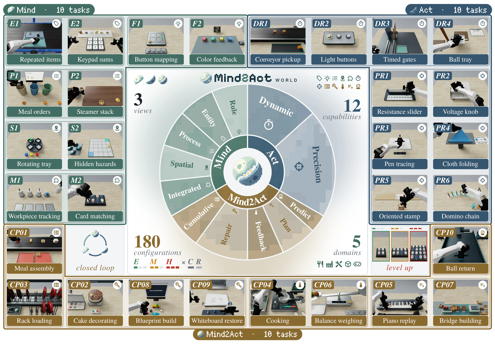

<div align="center">



<h4 align="center">
  <a href="https://arxiv.org/pdf/2611.26444">📄 Paper</a> |
  <a href="https://mind2act-world.com/">🌐 Webpage</a> |
  <a href="https://mind2act-world.com/leaderboard.html">🏆 Leaderboard</a> |
  <a href="https://mind2act-world.com/benchmark.html">🧩 Benchmark</a> |
  <a href="https://mind2act-world.com/diagnosis.html">🩺 Diagnosis</a> |
  <a href="https://mind2act-world.com/document.html">📖 Document</a> |
  <a href="https://huggingface.co/Mind2Act-World">🤗 Data</a>
</h4>

<p>
  <a href="https://arxiv.org/pdf/2611.26444"></a>&nbsp;
  &nbsp;
  &nbsp;
  &nbsp;
  
</p>

</div>

https://github.com/user-attachments/assets/d83241f1-bab5-4015-8894-484402551eca

<p align="center"><em>The full 1080p version is on the <a href="https://mind2act-world.com/">webpage</a>.</em></p>

Mind2Act World evaluates memory, physical execution, and tasks that require both.

## 📰 News

- **2026-11-19** — The technical report is on [arXiv](https://arxiv.org/pdf/2611.26444).
- **2026-11-11** — Per-task costs and timings, with inference benchmarks for the evaluated end-to-end models, are on the [leaderboard](https://mind2act-world.com/leaderboard.html#efficiency).
- **2026-11-10** — Results for the first four end-to-end models (π0.5, KinRT, X-VLA, G0.5) are [live](https://mind2act-world.com/leaderboard.html#board-e2e).
- **2026-11-09** — First results on the Agent leaderboard are [live](https://mind2act-world.com/leaderboard.html#board-agent).

## ✅ Release checklist

- [x] 🌐 Launch the benchmark website and task demonstrations.
- [x] 🏆 Publish initial VLA/WAM and multimodal-agent results.
- [x] ⏱️ Publish evaluation costs, timings and inference benchmarks.
- [x] 📄 Release the [technical report](https://arxiv.org/pdf/2611.26444).
- [ ] 📦 Release **Mind2Act Mini World**, a smaller, fully open-source benchmark designed to make training and evaluation more accessible.
- [ ] 🧪 Launch a **new agent leaderboard** for external submissions, with a standardized evaluation interface and sandboxed execution.

## ✨ Highlights

<p align="center">
  
</p>

<p align="center"><em><b>Overview of Mind2Act World.</b> The benchmark tests history-based cognitive reasoning (Mind), precise and timely physical execution (Act) and their closed-loop composition through environmental feedback (Mind2Act), both separately and in combination. Its 30 tasks come from five real-world application domains and run at three difficulty levels in Clean and Random scenes, and agents and end-to-end policies are ranked on separate leaderboards.</em></p>

- 🧠 **Three diagnostic views, 30 tasks** — 10 **Mind** tasks (memory and task decisions), 10 **Act** tasks (precise, timely, contact-rich execution) and 10 **Mind2Act** tasks where intent guides action and outcomes update the next decision.
- 🎚️ **Progressive pressure** — the full benchmark has 180 task, difficulty, and variation combinations. The development download contains clean training and validation layouts.
- 🔬 **Physics-verified, task-specific scoring** — scorers read physical measurements from the simulation, such as the final resistance.
- 🤖 **Two kinds of policy, one runner** — end-to-end VLA / WAM policies connect through [XPolicyLab](https://github.com/XPolicyLab/XPolicyLab); agents act through declared motion tools from a separately installed, checksum-pinned runtime.
- 🩺 **Model profile cards** — evaluation goes beyond a single score: selected models with distinctive behaviour get a [model profile card](https://mind2act-world.com/diagnosis.html) that records where its failed episodes first break down and whether the failure lies in Mind, Act or their composition.

## 🧩 Tasks

<p align="center">
  
</p>

<details>
<summary><b>Task list</b> (task IDs as used in this repository)</summary>

| View | ID | Task |
| :-- | :-- | :-- |
| 🟢 Mind | `E1` · `E2` | Duplicate Item Identification · Object-Code Keypad Entry |
| | `P1` · `P2` | Order-Based Meal Assembly · Steamer Stack Order Reconstruction |
| | `S1` · `S2` | Rotating Tray Layout Reconstruction · Hidden-Zone Navigation |
| | `F1` · `F2` | Unknown Button Mapping and Slider Navigation · Color-Block Trial Ordering |
| | `M1` · `M2` | Workpiece Tracking and Route Reproduction · Memory Card Matching |
| 🔵 Act | `DR1` · `DR2` | Continuous Conveyor Picking · Light-Guided Button Response |
| | `DR3` · `DR4` | Periodic Gate Crossing and Withdrawal · Ball-on-Tray Transport and Placement |
| | `PR1` · `PR2` | Linear Resistor Adjustment · Rotary Voltage Regulator Setting |
| | `PR3` · `PR4` | Marker Line Tracing · Cloth Edge Alignment and Placement |
| | `PR5` · `PR6` | Oriented Stamp Placement · Domino Chain Bell Ringing |
| 🟡 Mind2Act | `CP01` · `CP02` | Conveyor Meal Assembly · Rotating Cake Decoration |
| | `CP03` · `CP04` | Dynamic Rack Loading · Dual-Arm Cooking |
| | `CP05` · `CP06` | Keyboard Sequence Reproduction · Produce Weighing and Balancing |
| | `CP07` · `CP08` | Bridge Construction · Reference-Guided Block Construction |
| | `CP09` · `CP10` | Whiteboard Drawing Reconstruction · Predictive Ball Return and Red-Ball Avoidance |

Task pages with videos for every difficulty level are on the [benchmark page](https://mind2act-world.com/benchmark.html).

</details>

Training demonstrations are available in [mind2act-train](https://huggingface.co/datasets/Mind2Act-World/mind2act-train) on [Hugging Face](https://huggingface.co/Mind2Act-World).

## 🚀 Quick start

Use Linux, an NVIDIA GPU, and the Python 3.11 launcher supplied with Isaac Sim 5.1.
Download the [v1.0.1 development asset snapshot](https://huggingface.co/datasets/Mind2Act-World/mind2act-dev-assets/tree/8690686b0b5de5979c3fb516d5888f0df6df4b31/release-v1.0.1).
Set `ASSET_SNAPSHOT` to the downloaded repository root and `ISAAC_PYTHON` to the launcher.
The snapshot's `release-v1.0.1/RELEASE.json` pins the wheel and the Git commit
tagged `v1.0.1`. Users who already have v1.0.0 can use the smaller overlay from
the [GitHub release](https://github.com/Mind2Act/Mind2Act_World/releases/tag/v1.0.1).

```sh
cd "$ASSET_SNAPSHOT/release-v1.0.1"
sha256sum -c SHA256SUMS
for archive in archives/*.tar.zst; do tar --zstd -xf "$archive"; done
"$ISAAC_PYTHON" -m pip install 'code/mind2act_dev-1.0.1-py3-none-any.whl[isaac,agent,g05]'
```

Change to your deployment directory. Save the XPolicyLab configuration as
`config/e2e.json`, or the Mind2Act tool Agent configuration as `config/agent.json`.
Set `SPEC` to the layout JSON, `ASSET_ROOT` to its extracted asset root, and `GPU`
to the GPU index.

```sh
"$ISAAC_PYTHON" -m mind2act_eval.cli run --spec "$SPEC" --asset-root "$ASSET_ROOT" --e2e --gpu "$GPU"
```

Use `--agent` for the Mind2Act tool Agent (`m2a_agent:create`). It supports
`move_eef`, `wait_steps`, `memory_resolve`, and `give_up`. The selected mode
sets the task budget. See [Agent setup](docs/agent-runtime.md),
[XPolicyLab setup](policies/README.md), [container setup](docker/README.md),
and the [source layout](docs/source-layout.md).

## 📚 Documentation

| Document | Description |
| :-- | :-- |
| [Webpage documentation](https://mind2act-world.com/document.html) | Tasks and difficulty, evaluation protocol, leaderboard and release notes on the project website. |
| [Task catalogue](docs/tasks.md) | Instruction excerpts and success definitions for all 30 tasks. |
| [Agent runtime](docs/agent-runtime.md) | Tool calls and observations for multimodal agents. |
| [Policy interfaces](policies/README.md) | XPolicyLab and G0.5 connections for end-to-end policies. |
| [Container setup](docker/README.md) | Isaac Sim 5.1 image built from the pinned source. |
| [Source layout](docs/source-layout.md) | Source directories, installed modules and where to make changes. |
| [Development and evaluation](docs/submission.md) | Developing on public layouts and evaluating on held-out layouts. |
| [Validation status](docs/validation-status.md) | Checks run on the development layouts. |

## 🗂️ Repository Structure

```text
eval/       evaluation CLI, episode runner, scoring and budgets (mind2act_eval)
task/       30 task definitions with scenes, instructions and scorers
env/        Isaac Sim scene, X5 robot and scene variations
env_cfg/    shared layout admission and budget configs
policies/   Mind2Act tool Agent and XPolicyLab adapters
docker/     Isaac Sim 5.1 image definition
tools/      dependency installation helpers
tests/      runtime and Agent regression tests
docs/       documentation and README assets
```

## 🏆 Leaderboard

Live rankings are on the [Mind2Act World Leaderboard](https://mind2act-world.com/leaderboard.html), with separate boards for **End-to-end (VLA / WAM)** policies and **Agents** that act through tools, each reported by Mind, Act and Mind2Act view, in Clean and Random settings.

## 📝 Citation

If you find Mind2Act World useful, please cite our [technical report](https://arxiv.org/pdf/2611.26444):

```bibtex
@article{huang2026mind2actworld,
  title   = {{Mind2Act World}: A Diagnostic Benchmark for Embodied Mind, Physical Action, and Mind-Action Composition in Robotic Manipulation},
  author  = {Huang, Yuzhi and Wu, Jie and Huang, Fanding and Lin, Junchao and Zhang, Weichen and Xiong, Ziyi and Li, Yang and Xie, Zhengwei and Wang, Zhimin and Liu, Zhen and Huang, Jiazhen and Zhang, Yuzheng and Liu, Yuche and Yang, Hongyi and Tang, Chen and Tang, Shixiang and Aktas, Hakan and Wu, Adam and Wu, Duo and Ji, Kangye and Xie, Shuzhao and Liu, Huanan and Bu, Weijue and Li, Chenxin and Wang, Xinyuan and Bai, Tianyi and Mao, Yinan and Wang, Jiawei and Li, Minglei and Yu, Heng and Adeli, Ehsan and Li, Minchen and Li, Yong-Lu and Öztireli, Cengiz and Xu, Huazhe and Yu, Chao and Zhang, Jing and Zhang, Shanghang and Zhou, Weitao and Zhu, Wenwu and Chi, Cheng and Jiang, Jingyan and Wang, Zhi},
  journal = {arXiv preprint arXiv:2611.26444},
  year    = {2026},
  url     = {https://arxiv.org/abs/2611.26444}
}
```

## 🙏 Acknowledgements

Mind2Act World builds on [Isaac Sim](https://developer.nvidia.com/isaac/sim) and integrates policies through [XPolicyLab](https://github.com/XPolicyLab/XPolicyLab). The agent runtime installs pinned sources from RoboProbe (Apache-2.0) and [RoboDojo](https://github.com/RoboDojo-Benchmark/RoboDojo) (MIT), and verifies a separately installed [cuRobo](https://github.com/NVlabs/curobo); see [THIRD_PARTY.md](THIRD_PARTY.md). We thank their authors and maintainers.

## 🤝 Call for Collaboration and Sponsorship

Evaluating more models on Mind2Act World needs more GPU compute and API tokens. We welcome partners who can help with these resources and invite everyone to build the Mind2Act community with us.

- 🖥️ **GPU compute** for training, simulation and inference
- 🔑 **API credits** for agent evaluation
- 🗄️ **Hosting and storage** for datasets, videos and website services
- 🦾 **Robotics hardware** for real-world validation partnerships

Partners are acknowledged on the website, on the leaderboard and in the technical report, and a supported model can receive priority scheduling and a complete model profile card. Sponsorship never changes scores or rankings, and all models in the same track follow the same protocol. We also welcome research collaborations on new tasks, models and diagnosis methods.

To start a conversation, visit the [support page](https://mind2act-world.com/support.html) or email [Mind2ActCommittee@outlook.com](mailto:Mind2ActCommittee@outlook.com).

## 🏫 Affiliations

<p align="center">
  <a href="https://www.sigs.tsinghua.edu.cn/"></a>
</p>

Mind2Act World is built by the Mind2Act World Team at [mmlab@SIGS](https://mmlab-sigs.github.io/groups/zwang/), Tsinghua Shenzhen International Graduate School, together with researchers from the following universities and companies.

<p align="center">
  
</p>

## ⚖️ License

Original project code is distributed under [MIT](LICENSE). See
[THIRD_PARTY.md](THIRD_PARTY.md) for upstream code and asset terms.
