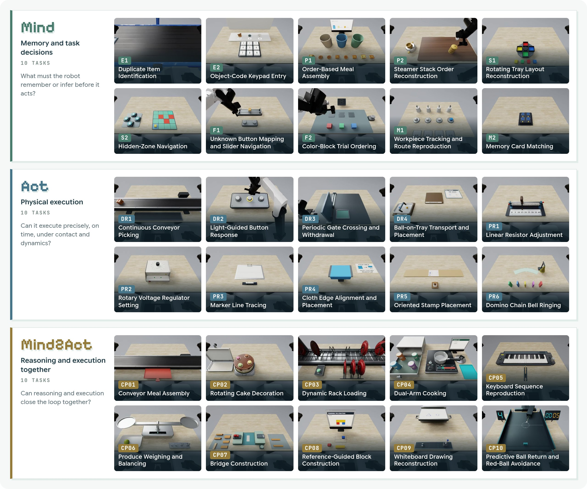

<div align="center">


<h3 align="center">
  <a href="https://mind2act-world.com/">🌐 Webpage</a> |
  <a href="https://mind2act-world.com/leaderboard.html">🏆 Leaderboard</a> |
  <a href="https://mind2act-world.com/benchmark.html">🧩 Benchmark</a> |
  <a href="https://mind2act-world.com/diagnosis.html">🩺 Diagnosis</a> |
  <a href="https://mind2act-world.com/resources.html">📖 Document</a> |
  📄 Report <sub>soon</sub>
</h3>

<p>
  &nbsp;
  &nbsp;
  &nbsp;
  
</p>

</div>

> **Final success alone cannot tell you where a robot breaks.** Mind2Act World separates the three things a long-horizon manipulation policy has to get right: what it must **remember and decide** (Mind), how precisely it can **execute** (Act), and whether reasoning and execution **close the loop together** (Mind2Act).

## 📰 News

- **2026-11-11** — Per-task costs and timings, with inference benchmarks for the evaluated end-to-end models, are on the [leaderboard](https://mind2act-world.com/leaderboard.html#efficiency).
- **2026-11-10** — Results for the first four end-to-end models (π0.5, KinRT, X-VLA, G0.5) are [live](https://mind2act-world.com/leaderboard.html#board-e2e).
- **2026-11-09** — First results for multimodal agents acting through tools are [live](https://mind2act-world.com/leaderboard.html#board-agent).
- **Coming soon** — Technical report and the full author list.

## ✨ Highlights

- 🧠 **Three diagnostic views, 30 tasks** — 10 **Mind** tasks (memory and task decisions), 10 **Act** tasks (precise, timely, contact-rich execution) and 10 **Mind2Act** tasks where intent guides action and outcomes update the next decision.
- 🎚️ **Progressive pressure** — every task has **Easy / Medium / Hard** fixed instances, each in a **Clean** scene and a frozen **Random** background variation: 180 task configurations in total.
- 🔬 **Physics-verified, task-specific scoring** — native scorers read the simulated outcome (resistance within ±0.2 Ω, the right key sequence, a balanced scale…), not a hand-labelled success flag.
- 🤖 **Two kinds of policy, one runner** — end-to-end VLA / WAM policies connect through [XPolicyLab](docs/xpolicylab.md); multimodal agents act through declared motion tools from a separately installed, checksum-pinned runtime.
- 🧪 **Clean episodes, honest batches** — each episode runs in a fresh Isaac Sim process; multi-GPU batches run at most one episode per GPU and keep failed attempts and infrastructure errors in the results.
- 🔒 **Reproducible by construction** — explicit action budgets, code ↔ asset release pairing, and source stamps that reject stale or modified checkouts.
- 🩺 **Diagnosis, not just a number** — the [diagnosis cards](https://mind2act-world.com/diagnosis.html) show how far each model gets, where failed episodes become unrecoverable, and why.

## 🧩 Tasks

<p align="center">
  
</p>

<details>
<summary><b>Task list</b> (task IDs as used in this repository)</summary>

| View | ID | Task |
| :-- | :-- | :-- |
| 🟢 Mind | `E1` · `E2` | Duplicate Item Identification · Object-Code Keypad Entry |
| | `P1` · `P2` | Order-Based Meal Assembly · Steamer Stack Order Reconstruction |
| | `S1` · `S2` | Rotating Tray Layout Reconstruction · Hidden-Zone Navigation |
| | `F1` · `F2` | Unknown Button Mapping and Slider Navigation · Color-Block Trial Ordering |
| | `M1` · `M2` | Workpiece Tracking and Route Reproduction · Memory Card Matching |
| 🔵 Act | `DR1` · `DR2` | Continuous Conveyor Picking · Light-Guided Button Response |
| | `DR3` · `DR4` | Periodic Gate Crossing and Withdrawal · Ball-on-Tray Transport and Placement |
| | `PR1` · `PR2` | Linear Resistor Adjustment · Rotary Voltage Regulator Setting |
| | `PR3` · `PR4` | Marker Line Tracing · Cloth Edge Alignment and Placement |
| | `PR5` · `PR6` | Oriented Stamp Placement · Domino Chain Bell Ringing |
| 🟡 Mind2Act | `CP01` · `CP02` | Conveyor Meal Assembly · Rotating Cake Decoration |
| | `CP03` · `CP04` | Dynamic Rack Loading · Dual-Arm Cooking |
| | `CP05` · `CP06` | Keyboard Sequence Reproduction · Produce Weighing and Balancing |
| | `CP07` · `CP08` | Bridge Construction · Reference-Guided Block Construction |
| | `CP09` · `CP10` | Whiteboard Drawing Reconstruction · Predictive Ball Return and Red-Ball Avoidance |

Task pages with videos for every difficulty level are on the [benchmark page](https://mind2act-world.com/benchmark.html).

</details>

## 🚀 Getting Started

### Installation

Use Linux with an NVIDIA GPU and an existing Isaac Sim 5.1 environment. Install with
that environment's Python:

```bash
git rev-parse HEAD > SOURCE_COMMIT
python -m pip install -e '.[isaac,xpolicy,coding-agent]'
```

Regenerate `SOURCE_COMMIT` after switching commits. Builds and formal runs reject
a stale stamp or tracked local modifications; commit intended changes before
creating a new paired version.

### Assets and release pairing

Scene and robot assets are downloaded separately. They currently require access to
[Lustin5209/mind2act-assets](https://huggingface.co/datasets/Lustin5209/mind2act-assets).
Use only an asset revision explicitly paired with this code revision. Historical
asset releases remain bound to their original code; do not edit their identity files
to bypass a mismatch. Use the `world-v1.0.0-candidate` asset revision paired with this exact code
commit. Native GPU acceptance is pending. Verify the selected pair before running:

```bash
python tools/verify_release_pair.py --asset-root /path/to/assets --expect-release v1.0.0
```

### Agent runtime

For multimodal agents (the `coding-agent` extra), install the runtime from pinned upstream files and the robot assets:

```bash
python tools/install_coding_agent.py --out /path/to/agent-runtime --asset-root /path/to/assets
```

Set `source_root` in the adapter configuration to this output directory. The installer
checks both downloaded and installed hashes and keeps the dependency licences.
See [installation](docs/new-machine-setup.md) and [dependency notices](THIRD_PARTY.md).

## 🎮 Run a Fixed Case

Use the selected release's exact case ID and frozen execution limits. Run
`mind2act-eval run --help` for the model adapter, config, GPU and budget options.
The release checks reject mismatched inputs; an episode seed identifies its fixed case
and is not sent to the model service. Internal task phases are not model observations.

For a batch, provide a JSON list of the corresponding CLI options, using underscores
in option names. A static GPU assignment can be requested with:

```bash
mind2act-eval batch --manifest jobs.json --gpus 0,1 --output-root /path/to/results
```

Each task is assigned to one GPU; that GPU executes its cases serially. Results retain
failed attempts and infrastructure errors. There is no distributed queue or capacity
leasing service in this package.

## 🗺️ Load All Scenes Without a Model

Create `scenes.json` containing exactly one clean fixed instance per task and difficulty:

```json
[
  {"spec": "assets/PR1/easy/spec.json", "asset_root": "assets"}
]
```

The example shows the row format; a full manifest must contain all 90 cells. Paths are
relative to the manifest. Keep the selected instance IDs and spec bytes unchanged.

```bash
python tools/scene_check.py --manifest scenes.json --out scene-plan --plan-only
python tools/scene_check.py --manifest scenes.json --out scene-results --gpu 0
```

The first command checks the complete selection on CPU. The second loads each scene
in a fresh process, holds the initialized robot targets for 600 physics ticks, and
writes `results.json`, `failures.json` and `first-frames.jpg`. Inspect the contact sheet
for missing objects, bad materials and black images. Loading success is not a model
score or proof of visual equivalence. GPU validation of this new command is pending.

## 🧪 CPU Checks

```bash
python -m pip install -e '.[test,coding-agent]'
MIND2ACT_CODING_AGENT_SOURCE_ROOT=/path/to/agent-runtime python -m pytest -q
```

Some SDK integration checks require the installed runtime. Tests never start Isaac Sim
or contact a model service. Report skipped dependencies as well as failures.

## 📚 Documentation

| Document | What it covers |
| :-- | :-- |
| [New-machine setup](docs/new-machine-setup.md) | Driver, Isaac Sim Python and first-run checks on a fresh machine. |
| [Runtime and acceptance](docs/runtime.md) | Runtime requirements and acceptance steps. |
| [Task and adapter contract](docs/contracts.md) | Public types shared by tasks, adapters and the runner. |
| [XPolicyLab adapter](docs/xpolicylab.md) | How end-to-end policies connect through XPolicyLab. |
| [Policy I/O clock](docs/policy-io-clock.md) | Control and RGB rates expected by the supported model profile. |
| [Run budgets](docs/e2e-budgets.md) | Frozen physics budgets for end-to-end policies and multimodal agents. |
| [Frozen background variations](docs/variations.md) | How Random overlays a frozen Clean instance. |
| [Asset release contract](docs/release-contract.md) | Code ↔ asset pairing checks. |
| [Test instances](docs/test-instance-catalog.md) | Selecting frozen test instances by case ID. |
| [Episode storage](docs/episode-storage.md) · [Video rendering](docs/video-rendering.md) | Where episodes, caches and videos go. |
| [Compatibility test matrix](docs/test-matrix.md) · [Bug report](docs/bug-report.md) | External testing plan and issue template. |
| [Per-task notes](docs/tasks/) | Task-specific implementation notes. |

## 🗂️ Repository Structure

```text
task/        task construction, mechanisms, task configuration and scoring   → mind2act_eval.tasks
env/sim/     Isaac simulation, rendering, physics and materials              → mind2act_eval.sim
env_cfg/     robot profiles, geometry configuration and robot integration    → mind2act_eval.robot
eval/        episode runner, CLI, budgets and release checks                 → mind2act_eval
policies/    model adapters and agent integration                            → mind2act_eval.adapters
tools/       release pairing, scene check, agent runtime installer
manifests/   frozen budgets and run manifests
examples/    CPU demo for the agent path
tests/       CPU contract tests
docs/        documentation
```

<details>
<summary><b>Notes on the package layout</b></summary>

Scene payloads live in the separate asset repository. Task-specific JSON stays
with its task so configuration and mechanisms can be reviewed together.

Setuptools maps these directories into one installable Python namespace. Install
with `python -m pip install -e .` before running from a checkout; setting
`PYTHONPATH` alone does not install the package mapping. CLI names, adapter module
names and external model configuration remain unchanged. Wheels include the same
package resources and can run from outside the checkout.

The `env/` container has no Python initializer, avoiding a name collision with
the external planner runtime's `env` namespace.

</details>

## 🏆 Leaderboard

Live rankings are on the [Mind2Act World Leaderboard](https://mind2act-world.com/leaderboard.html), with separate boards for **VLA / WAM** end-to-end policies and **multimodal agents** acting through tools, each reported by Mind, Act and Mind2Act view, in Clean and Random settings.

## 📝 Citation

The technical report is coming soon. Until then, please cite the project as:

```bibtex
@misc{mind2actworld2026,
  title        = {{Mind2Act World}: A Diagnostic Benchmark for Embodied Mind, Physical Action, and Mind-Action Composition in Robotic Manipulation},
  author       = {{Mind2Act World Team}},
  year         = {2026},
  howpublished = {\url{https://mind2act-world.com}}
}
```

## 🙏 Acknowledgements

Mind2Act World builds on [Isaac Sim](https://developer.nvidia.com/isaac/sim) and integrates policies through [XPolicyLab](https://github.com/XPolicyLab/XPolicyLab). The agent runtime installs pinned sources from RoboProbe (Apache-2.0) and [RoboDojo](https://github.com/RoboDojo-Benchmark/RoboDojo) (MIT), and verifies a separately installed [cuRobo](https://github.com/NVlabs/curobo); see [THIRD_PARTY.md](THIRD_PARTY.md). We thank their authors and maintainers.

## 🏫 Affiliations

<p align="center">
  <a href="https://www.sigs.tsinghua.edu.cn/"></a>
</p>

Mind2Act World is built by the Mind2Act World Team at [mmlab@SIGS](https://mmlab-sigs.github.io/groups/zwang/), Tsinghua Shenzhen International Graduate School.

## ⚖️ License

Original project code is released under the [MIT License](LICENSE). Third-party code and assets retain their
own terms; the project licence does not relicense them.
